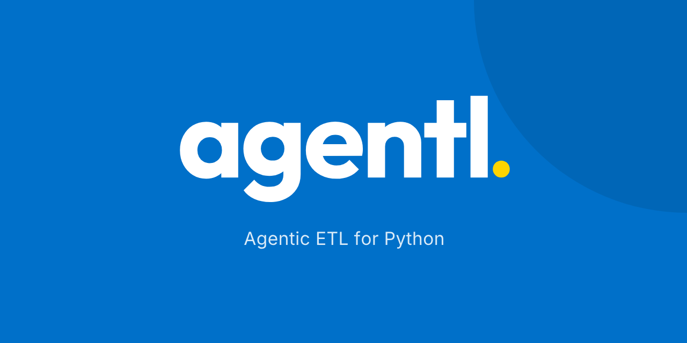

<p align="center">
  <a href="https://agentl.com.br">
    
  </a>
</p>

<p align="center">
  <a href="https://agentl.com.br"><b>Website</b></a> ·
  <a href="https://agentl.com.br/getting-started/">Getting started</a> ·
  <a href="https://agentl.com.br/connectors/">Connectors</a> ·
  <a href="https://pypi.org/project/agentl-etl/">PyPI</a> ·
  <a href="https://agentl.com.br/roadmap/">Roadmap</a> ·
  <a href="https://github.com/arimayuji/agentl/discussions">Discussions</a>
</p>

[](https://github.com/arimayuji/agentl/actions/workflows/ci.yml)
[](https://pypi.org/project/agentl-etl/)
[](https://pypi.org/project/agentl-etl/)
[](LICENSE)
[](https://scorecard.dev/viewer/?uri=github.com/arimayuji/agentl)

**Agentic ETL in YAML.** Read files, APIs and databases, let an LLM classify or extract each
record against a schema, check the data, and deliver it. Per-record cache, budgets, retries and a
live dashboard come built in.

<p align="center"></p>

- **Pay once per record:** a re-run of unchanged data makes no model calls, and a job that failed
  halfway only pays for what did not finish ([before and after](https://agentl.com.br/cases/)).
- **Data you can trust:** `check` steps with fixed rules and an agent review before delivery.
- **Works where your data is:** CSV, Excel, PDF, SQL, Postgres, S3, SharePoint, Google Sheets,
  Kafka, SQS, webhooks, and an MCP server for Claude Code and Cursor.
- **Honest numbers:** [benchmarks](https://agentl.com.br/performance/) and
  [evals](https://agentl.com.br/evals/) against plain Python, including where it loses.

> Status: beta (v0.8). Minor releases may still change the API; every change is in the [changelog](CHANGELOG.md).

**For AI agents:** the docs are at [agentl.com.br/llms.txt](https://agentl.com.br/llms.txt), and every docs page has a raw Markdown copy (`<page>/index.md`).

## Install

```bash
pip install agentl-etl                 # core: CSV, JSON, HTTP, SQLite, runner, dashboard
pip install 'agentl-etl[office,pdf]'   # Excel, Word, PDF
pip install 'agentl-etl[anthropic]'    # Claude as the LLM provider
pip install 'agentl-etl[all]'
```

The distribution is named `agentl-etl` on PyPI; the import and the CLI are both `agentl`.

## A pipeline

```yaml
name: invoices
llm:
  provider: anthropic          # or "echo" to run offline
  model: claude-opus-5-5

steps:
  - id: invoices
    use: csv.read
    with: { path: data/invoices.csv }

  - id: customers
    use: json.read
    with: { path: data/customers.json }

  - id: matched
    use: join
    input: [invoices, customers]
    with: { left: invoices, right: customers, on: tax_id, how: left }

  - id: classify
    agent: Classify the expense category and flag unknown clients for review.
    input: matched
    output: { number: str, customer: str?, category: str?, needs_review: bool? }

  - id: save
    use: sqlite.write
    input: classify
    with: { db: out/invoices.db, table: invoices }

notify:
  channels:
    slack: { webhook: "${SLACK_WEBHOOK}" }
  rules:
    - on: run.failed
      to: [slack]
      summary: agent             # the LLM explains the failure in 3 lines
    - on: item.rejected
      when: "rate > 0.05"
      to: [slack]
```

```bash
agentl validate pipeline.yaml
agentl run pipeline.yaml --show classify
agentl diagram pipeline.yaml      # Mermaid
agentl dashboard                  # http://127.0.0.1:7070
```

You can also write `extract:`, `transform:` and `load:` sections instead of `steps:`. Inside `transform` and `load`, a step without `input` reads from the previous one.

## Concepts

**Everything is a step.** A step gets records (`list[dict]`) from its inputs and returns records. Extract, transform and load are labels, not different machinery. Steps form a graph, so ETL, ELT, fan-out and joins all fit.

| Step kind | YAML | Use for |
|---|---|---|
| Connector | `use: pdf.read` | Reading and writing files, APIs and databases |
| Function | `fn: my_module:clean` | Your own deterministic code |
| Agent | `agent: "..."` + `output:` | Semantic work: classify, extract, normalize, audit |

**Agent steps** run once per record, in parallel (`concurrency`), and must declare an `output` schema (`str`, `int`, `float`, `bool`, `list[str]`, `dict`; a trailing `?` means optional). Outputs are validated; a record that fails twice is rejected, not the whole run, and shows up as an `item.rejected` event. Results are cached per record in `.agentl/agentl.db`, so re-running after a crash only pays for what is left.

**Secrets** come from the environment: `${VAR}` or `${VAR:-default}`. Never put them in the YAML.

## Built-in connectors

`file.read` `csv.read` `csv.write` `json.read` `json.write` `txt.read` `excel.read` `parquet.read` `pdf.read` `docx.read` `doc.read` `xml.read` `html.read` `http.get` `http.post` `sqlite.read` `sqlite.write` `select` `filter` `dedupe` `join` `concat`

`file.read` detects the format and expands ZIP/GZ archives. Readers accept `path` (glob), `url` (HTTP download) or upstream records. `agentl connectors` lists what is installed. `http.get` accepts `{field}` placeholders in the URL to make one request per upstream record, plus `items: data.results` to pick the list out of the response.

## Extending

```python
from agentl import connector, register_provider


@connector("crm.contacts")
def contacts(input, since=None):
    return [{"id": 1, "email": "a@b.com"}]
```

Packages can register connectors through the `agentl.connectors` entry point group, so `pip install agentl-yourthing` is enough. LLM providers plug in with `register_provider(name, factory)`; the factory returns an object with `structured(instruction, record, schema)` and `text(instruction, content)`.

## Events

The runner emits `run.started`, `step.started`, `step.succeeded`, `step.failed`, `item.rejected`, `source.empty`, `run.succeeded` and `run.failed`. They feed the store, the dashboard and notification rules (`slack`, `webhook`, `console`).

## Roadmap

Next up: a pandas bridge, Postgres with upsert and docs for AI agents.
See the full [public roadmap](https://agentl.com.br/roadmap/) and vote on the issues you need.

## Contributing

Bug reports, connector requests and pull requests are welcome. Read [CONTRIBUTING.md](CONTRIBUTING.md)
for the setup and the checks every PR must pass, and [SECURITY.md](SECURITY.md) to report vulnerabilities privately.
Release history is in [CHANGELOG.md](CHANGELOG.md).

## Sponsors

agentl is free and MIT licensed. If it saves you time, consider [sponsoring the project](https://github.com/sponsors/arimayuji).

## License

MIT
