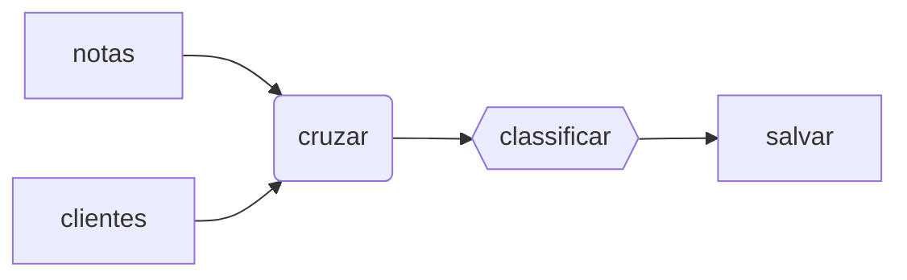

# CLI and dashboard

```text
agentl run PIPELINE [--no-cache] [--show STEP]
agentl validate PIPELINE
agentl diagram PIPELINE
agentl runs
agentl connectors
agentl dashboard [--host 127.0.0.1] [--port 7070]
```

Every command accepts `--db PATH` to choose the run store (default `.agentl/agentl.db`).

## Diagram

`agentl diagram` prints the pipeline as Mermaid. Connectors are boxes, functions are rounded and
agents are hexagons:



## Dashboard

`agentl dashboard` serves a local page with recent runs, the event log and the pipeline diagram colored
by step status. It binds to `127.0.0.1` by default. Do not expose it publicly: it has no authentication.
